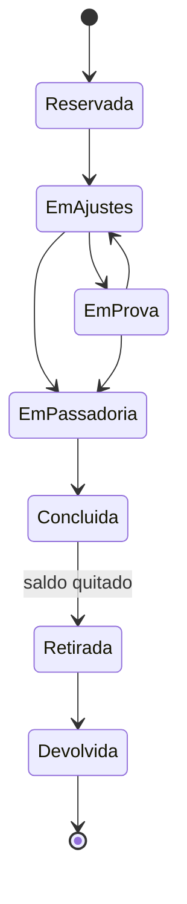

# Linho – Sistema de Gestão de Ateliê

Sistema web para a gestão de ateliê, que trabalha com **locação de trajes** e **confecção sob medida**. O Linho organiza clientes, inventário de peças, ordens de serviço, produção, pagamentos e finanças, e inclui um **agente inteligente de precificação** que sugere preços com base na meta mensal do ateliê.

Projeto desenvolvido por [Anna Julya](https://github.com/anninha05) na disciplina de **Paradigma Orientado a Objetos para Desenvolvimento de Software (POODS)** da UENF.

## Funcionalidades

| Módulo | O que faz |
|---|---|
| **Dashboard** | Indicadores do ateliê, agenda do dia (provas, retiradas, entregas e devoluções) e ritmo da produção |
| **Clientes** | Cadastro, edição e histórico de ordens de cada cliente |
| **Inventário de peças** | Peças de locação e sob medida, com estados (disponível, alugada, em costura, em lavagem, em manutenção) |
| **Ordens de serviço** | Fluxos de locação e sob medida, reagendamento, contrato em PDF, página de detalhes com acompanhamento do fluxo |
| **Fila de costura** | Bancada da produção organizada por etapa, com medidas e instruções de cada peça |
| **Pagamentos** | Sinal, pagamentos parciais, quitação, recibos e pendência de acerto em cancelamentos |
| **Financeiro** | Recebimentos, despesas e resultado de caixa por mês |
| **Precificação inteligente** | Meta mensal, agente PID com calibração por simulação e sugestão de preço aprovada pela gerência |
| **Usuários e perfis** | Administração, atendimento e produção, cada um com as telas e ações do seu papel |

O frontend é um **PWA** responsivo: funciona no computador e pode ser instalado no celular.

### Perfis de acesso

| Perfil | Acesso |
|---|---|
| **Administração** | Todo o sistema, incluindo financeiro, precificação e gestão de usuários |
| **Atendimento** | Dashboard, clientes, peças, ordens de serviço e pagamentos |
| **Produção** | Fila de costura e avanço das etapas de produção |


## Tecnologias

**Backend**


**Frontend**


**Infraestrutura**


## Arquitetura

O projeto é organizado **por funcionalidade** (feature), tanto no backend quanto no frontend: cada pasta reúne entidade, regras, repositório, serviço e controlador de um mesmo assunto.

```
backend/src/main/java/com/atelie/sistema
├── cliente/          Cadastro de clientes
├── peca/             Inventário e estados das peças (padrão State)
├── ordemservico/     Ordens, pagamentos, recebimentos, contrato em PDF
│   └── state/        Estados da ordem de serviço (padrão State)
├── financeiro/       Despesas e indicadores
├── dashboard/        Agenda de compromissos
├── precificacao/     Metas, política, sugestão e aprovação de preços
│   └── agente/       Agente de IA, simulador, calibração e experimentos
├── usuario/          Usuários, perfis e autenticação
└── shared/           Configurações, exceções e validações

frontend/src
├── app/              Rotas e layout
├── features/         Telas por funcionalidade
└── shared/           Componentes, estilos e chamadas à API
```

### Destaques de orientação a objetos

- **Padrão State nas ordens de serviço:** cada etapa (`Reservada`, `EmConfeccao`, `EmProva`, `EmAjustes`, `EmPassadoria`, `Concluida`, `Retirada`, `Entregue`, `Devolvida`, `Cancelada`) é uma classe que define as transições válidas e as **ações disponíveis**. O backend calcula as ações permitidas para cada perfil, e o frontend apenas as exibe.
- **Padrão State nas peças:** os estados do inventário controlam quando uma peça pode ser alugada, enviada para costura ou lavagem.
- **Encapsulamento das regras financeiras:** `Pagamento` concentra as regras de sinal, pagamento parcial, quitação e saldo devedor, nenhum valor é alterado fora da própria entidade.
- **Erros padronizados:** exceções de negócio são convertidas em respostas JSON uniformes.

Fluxo de uma ordem de **locação**:



No fluxo **sob medida**, a ordem passa por `EmConfeccao` antes da prova e termina em `Entregue`. Em qualquer etapa até a conclusão, a ordem pode ser reagendada ou cancelada.

## Como executar localmente

### Pré-requisitos

- Java 21
- Node.js 20+
- Docker e Docker Compose

### 1. Variáveis de ambiente

Na raiz do projeto, copie o arquivo de exemplo e preencha os valores:

```bash
cp .env.example .env
```

| Variável | Descrição |
|---|---|
| `DB_USER`, `DB_PASSWORD`, `DB_NAME` | Credenciais do PostgreSQL |
| `ADMIN_EMAIL`, `ADMIN_PASSWORD` | Usuário administrador criado automaticamente na primeira execução |
| `FRONTEND_ORIGIN` | Origem do frontend em desenvolvimento (padrão `http://localhost:5173`) |
| `DOMINIO` | Usado apenas no deploy (ver abaixo) |

### 2. Banco de dados

```bash
docker compose up -d
```

Sobe apenas o PostgreSQL em `localhost:5432`. As tabelas são criadas pelo Flyway quando o backend inicia.

### 3. Backend

```bash
cd backend
./mvnw spring-boot:run        # Linux/macOS
.\mvnw.cmd spring-boot:run    # Windows
```

A API fica disponível em `http://localhost:8080`.

### 4. Frontend

```bash
cd frontend
npm install
npm run dev
```

Acesse `http://localhost:5173` e entre com o `ADMIN_EMAIL` e o `ADMIN_PASSWORD` do `.env`. Os usuários de atendimento e produção podem ser criados em **Meu perfil → Gerenciar usuários**.

## Deploy na AWS EC2

Em produção, o `docker-compose.yml` sobe quatro serviços com o perfil `producao`:

```
Internet ──► Caddy (80/443, HTTPS automático) ──► Nginx (frontend) ──► /api ──► Spring Boot ──► PostgreSQL
```

### Passo a passo

1. Crie uma instância **Ubuntu 24.04** (recomendado `t3.small`) com as portas **22**, **80** e **443** liberadas no Security Group.
2. Instale o Docker:
   ```bash
   curl -fsSL https://get.docker.com | sudo sh
   sudo usermod -aG docker ubuntu    # depois saia e entre novamente
   ```
3. Clone o repositório e crie o `.env`:
   ```bash
   git clone https://github.com/anninha05/sistema-gestao-atelie.git
   cd sistema-gestao-atelie
   nano .env
   ```
   ```
   DB_USER=atelie
   DB_PASSWORD=<senha-forte>
   DB_NAME=atelie_db
   ADMIN_EMAIL=<email-do-admin>
   ADMIN_PASSWORD=<senha-forte>
   DOMINIO=<ip-publico>.sslip.io
   ```
   `DOMINIO` pode ser um domínio próprio apontado para o IP da instância ou, sem domínio, o endereço gratuito `<ip>.sslip.io`. Em ambos os casos o Caddy gera o certificado HTTPS automaticamente.
4. Suba a aplicação:
   ```bash
   docker compose --profile producao up -d --build
   ```
5. Para atualizar após novas alterações na `main`:
   ```bash
   git pull && docker compose --profile producao up -d --build
   ```
## Módulo de IA: Agente Inteligente de Precificação

Este repositório também contém o trabalho da disciplina de **Inteligência Artificial**: um agente com aprendizado que sugere ajustes de preço para o ateliê atingir a meta de faturamento do mês.

### Por que o agente está dentro do sistema?

O agente foi pensado para o ateliê real atendido pelo Linho. Por isso ele fica integrado ao backend:

- lê do banco a **meta do mês**, os **recebimentos** e as **despesas**;
- registra cada decisão diária;
- gera uma **sugestão de preço** para ordens reservadas, que **só é aplicada depois da aprovação da administradora**.

O núcleo do agente (controlador PID, simulador e calibração com Twiddle) foi escrito **do zero em Java 21**, sem bibliotecas de IA, e pode ser executado **sem banco de dados e sem o restante do sistema**.

### Onde está o código

```
backend/src/main/java/com/atelie/sistema/precificacao/
├── ControladorPID.java           # decisão: PID com saturação e anti-windup
├── PrecificacaoService.java      # integração com os dados reais do sistema
├── SugestaoPrecoService.java     # sugestão de preço e aprovação
└── agente/
    ├── AgentePrecificacao.java       # percepção e decisão do agente
    ├── AmbienteAtelie.java           # simulador de um mês do ateliê (Poisson)
    ├── CalibradorGanhos.java         # aprendizado dos ganhos (Twiddle)
    └── ExperimentoPrecificacao.java  # treino, teste e geração dos resultados
```

### Pré-requisitos

- **Java 21**: é o único requisito para rodar os experimentos.
- **Python 3 com matplotlib**: opcional, só para gerar os gráficos.

### Como rodar os experimentos

Na pasta `backend`:

**Linux / macOS**
```bash
./mvnw compile
java -cp target/classes com.atelie.sistema.precificacao.agente.ExperimentoPrecificacao ../experimentos
```

**Windows (PowerShell)**
```powershell
.\mvnw.cmd compile
java -cp target\classes com.atelie.sistema.precificacao.agente.ExperimentoPrecificacao ..\experimentos
```

O programa calibra o agente, compara três abordagens (preço fixo, PID com ganhos manuais e PID calibrado) em cinco cenários de mercado e grava os resultados na pasta `experimentos`:

| Arquivo | Conteúdo |
|---|---|
| `convergencia.csv` | custo a cada iteração do Twiddle |
| `resultados.csv` | desempenho dos três agentes nos cenários de teste |
| `trajetoria.csv` | um mês de baixa temporada, dia a dia |

Os resultados são reproduzíveis: as sementes aleatórias são fixas.

### Testes do agente

```bash
./mvnw test -Dtest=AgentePrecificacaoTest,ControladorPIDTest
```

### Uso no sistema

Com o sistema rodando, entre como **administradora** e acesse **Financeiro → Precificação** para:

- definir a meta do mês;
- recalibrar os ganhos;
- gerar e aprovar sugestões de preço.

O relatório completo do trabalho (PEAS, metodologia, resultados e limitações) foi entregue separadamente na disciplina.
